# Informações sobre a avaliação

**AV2 — AVALIAÇÃO 2 — 25 pontos**

## Informações docente

| Curso                  | Disciplina | Turno                           | Período/Sala | Professor(a)                |
| ---------------------- | ---------- | ------------------------------- | ------------ | --------------------------- |
| Engenharia de Software | DIAW       | Manhã (x), Tarde (x), Noite (x) | 2º           | João Paulo Carneiro Aramuni |

## Instruções

### 1) Consulta

I) Será permitido consultar os seus próprios projetos desenvolvidos em laboratório.

II) Será permitido consultar a documentação oficial do React (react.dev), do Vite (vite.dev), do React Router (reactrouter.com) e do W3C (w3.org) para HTML e CSS.

III) Não será permitido o uso de inteligência artificial, como o ChatGPT, Claude AI, Gemini, GitHub Copilot, etc., bem como consultas ao Google ou a qualquer outro site de busca.

### 2) Tecnologias

Será obrigatório o uso de Node.js, React, Vite, React Router (react-router-dom), JavaScript (JSX), HTML e CSS.

### 3) Aparelhos eletrônicos

Não será permitido o uso de celulares, relógios digitais ou qualquer outro aparelho eletrônico durante a realização da prova.

### 4) Conduta

O aluno que, durante a prova, utilizar meios ilícitos, como comunicação com outros alunos, consulta a qualquer tipo de material extra prova ou uso de aparelhos eletrônicos, será eliminado do processo avaliativo e receberá nota 0 (zero).

### 5) Funcionamento

Projetos que não rodam, ou seja, que apresentam erro no `npm run dev`, ou que não possam ser acessados via http://localhost:5173/ serão avaliados com até no máximo 50% da nota da prova (12,5 pts).

**Boa Prova!**

# Sistema de Votação Craque do Jogo: Galo 2026


O Galo venceu o clássico por 3 x 1 na Arena MRV e agora a torcida escolhe o melhor em campo! Everson, Renan Lodi, Gustavo Scarpa e Mateo Cassierra foram indicados ao prêmio, e Lyanco cumpriu suspensão e não entrou em campo. O torcedor vota em quem foi o Craque do Jogo: quem receber mais votos leva o troféu. Você deve construir, com React e Vite, uma aplicação em que seja possível selecionar um dos jogadores indicados e confirmar o voto nele e ver a contabilização total dos votos, com o percentual de cada jogador, quem é o craque e quem é o vice. Os votos devem ficar salvos no navegador (localStorage), usando o service disponibilizado na prova.

**Elenco do Atlético Mineiro 2026:**

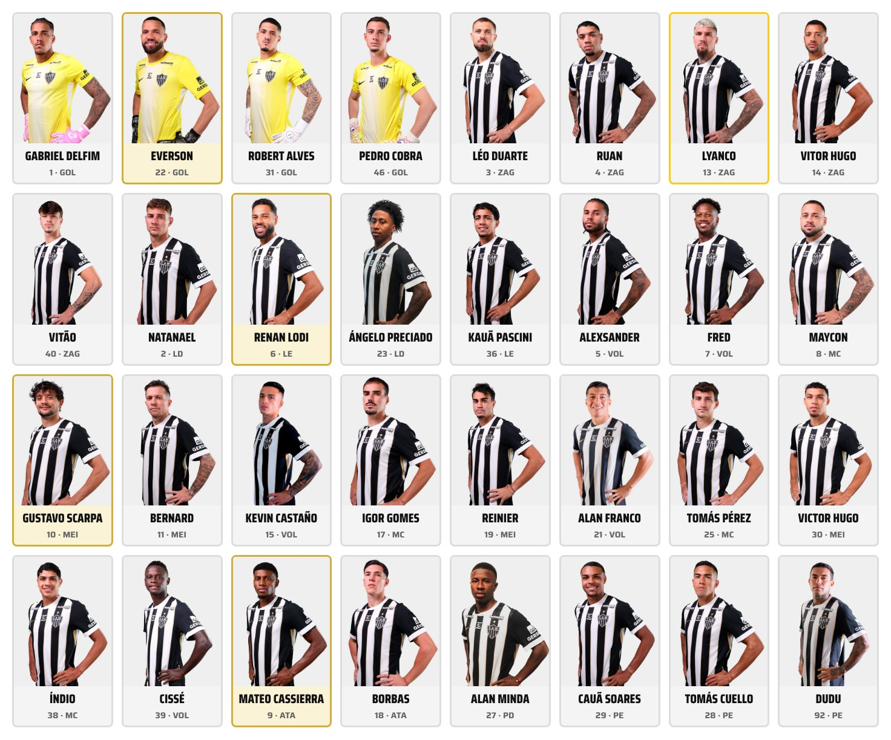

## [10,0 pts] Questão 1

Construa os arquivos `components/JogadorCard.jsx` e `pages/Votacao.jsx` e realize as chamadas necessárias para os arquivos disponibilizados na prova, chamados `services/votacaoService.js` e `data/jogadores.js`.

### Dicas: Componente JogadorCard

- É um componente de função que recebe por props o objeto `jogador`, o booleano `selecionado` (com valor padrão `false`) e, opcionalmente, a função `onSelecionar`. Desestruture as props direto na assinatura, já definindo o valor padrão. O card deve exibir a foto, o número da camisa, o nome e a posição do jogador:

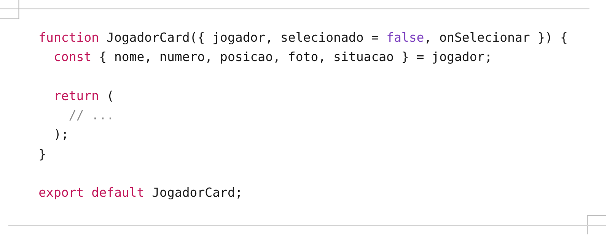

- O campo `situacao` de cada jogador pode ser `'indicado'`, `'suspenso'` ou `'elenco'`. Em vez de encadear vários ternários, use um objeto de mapeamento para descobrir o texto do selo. Os demais jogadores do elenco não têm selo: `SELOS['elenco']` devolve `undefined` e o `&&` esconde o selo:

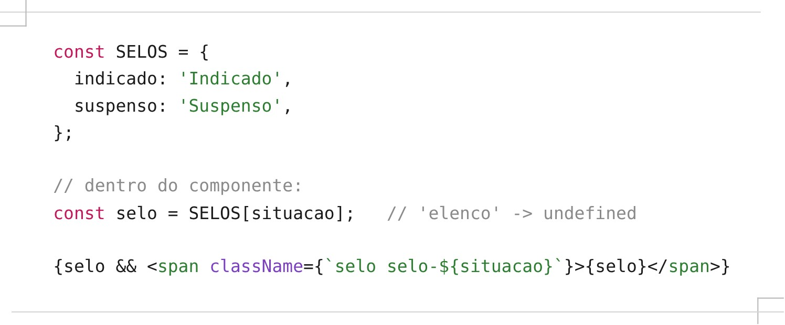

- Monte o `className` do card com template string: a classe `card-${situacao}` sempre aparece (`card-indicado`, `card-suspenso` ou `card-elenco`) e a classe `card-selecionado` só entra quando `selecionado` for `true`:

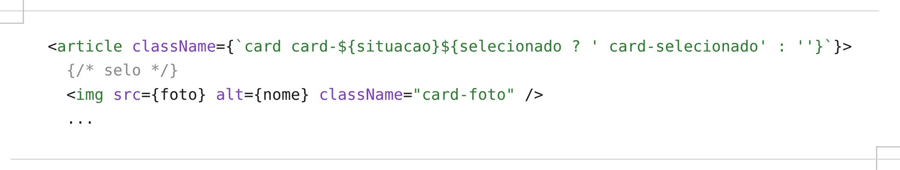

- O botão só deve aparecer quando `onSelecionar` for passado. O texto do botão muda conforme `selecionado` (“Selecionar” ou “✓ Selecionado”). No `onClick`, use uma arrow function para enviar o jogador. Escrever `onClick={onSelecionar(jogador)}` executaria a função na renderização, e não no clique:

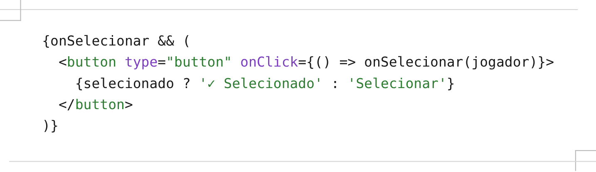

### Dicas: Página Votacao

- Importe do service as funções `listarPorSituacao(situacao)`, `obterSuspenso()` e `registrarVoto(id)`. Confira os nomes exatos no arquivo `votacaoService.js` fornecido. Atenção: o `id` de cada jogador agora é um texto (ex.: `'gustavo-scarpa'`), e não um número. Use `listarPorSituacao('indicado')` e `listarPorSituacao('elenco')`.
- O voto tem duas etapas: primeiro o usuário seleciona um jogador, depois confirma. Guarde no estado (`useState`) o jogador selecionado (ainda sem voto) e um array com o histórico dos nomes em que o usuário já votou desde que abriu a página:

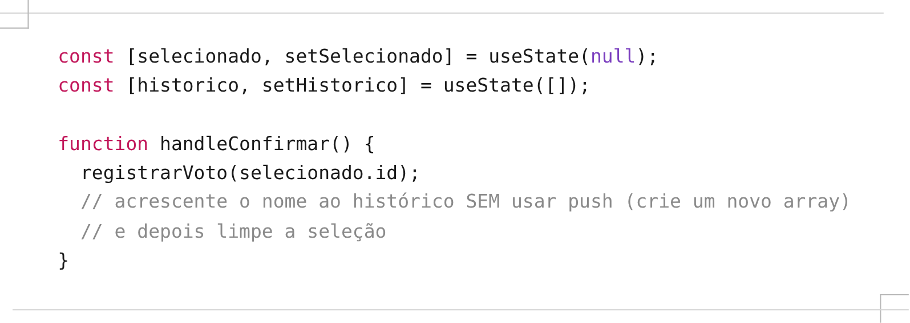

- Renderize os 4 jogadores indicados com `map()`, sempre informando a `key`. Como `selecionado` pode ser `null`, use o encadeamento opcional (`?.`) para comparar os ids. Repare que a própria função `setSelecionado` pode ser passada como `onSelecionar`:

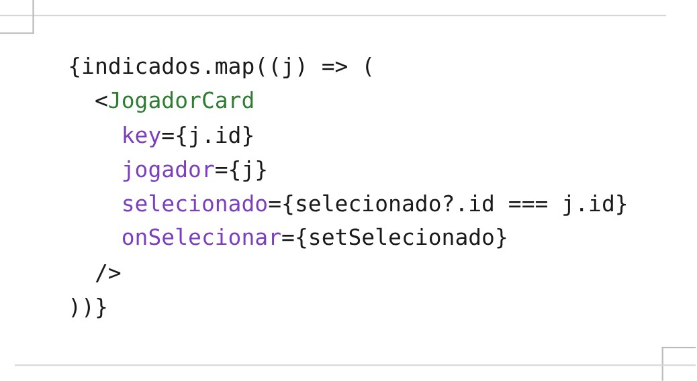

- Abaixo da grade dos indicados, crie uma barra de confirmação (classe `confirmacao`) com:
    - o texto “Seu voto vai para &lt;nome&gt;.” quando houver alguém selecionado, ou “Nenhum jogador selecionado.” caso contrário;
    - o botão **Confirmar voto**, que deve ficar desabilitado (atributo `disabled`) enquanto ninguém estiver selecionado e que chama `handleConfirmar` no clique.
- Exiba o histórico somente quando houver pelo menos um voto na sessão (`historico.length > 0`), mostrando:
    - a quantidade de votos da sessão (cuidado com o singular e o plural: “1 voto”, “2 votos”);
    - uma lista ordenada (`<ol>`) com o nome de cada voto, na ordem em que foram dados;
    - um `Link` para a página `/resultado`.
- Mostre o jogador suspenso (`obterSuspenso()`) e os demais jogadores do elenco (`listarPorSituacao('elenco')`) reutilizando o mesmo `JogadorCard` sem passar `onSelecionar`. Assim eles aparecem sem botão.

## [10,0 pts] Questão 2

Construa os arquivos `App.jsx` e `pages/Resultado.jsx`.

### Dicas: Rotas da aplicação (App.jsx)

- Instale o React Router com o comando `npm install react-router-dom`.
- Envolva a aplicação com `BrowserRouter`. O `Header` fica fora do `Routes`, para aparecer em todas as páginas. O `Header` fornecido usa `NavLink`, que só funciona dentro do `BrowserRouter`.
- Crie as três rotas: `/` (Home), `/votacao` (Votacao) e `/resultado` (Resultado).
- Crie também uma rota coringa (`path="*"`) que redirecione qualquer outro endereço (ex.: `/qualquer-coisa`) para a Home, usando o componente `Navigate` de `react-router-dom`. Use `replace` para que o endereço inválido não fique no histórico do navegador:

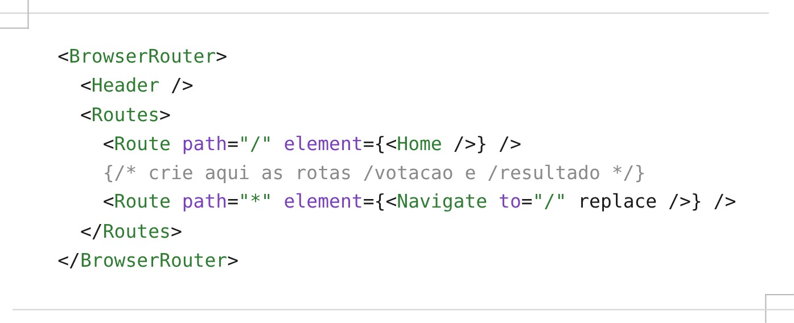

- Não se esqueça de importar o arquivo `App.css` no `App.jsx`.

### Dicas: Página Resultado

- Inicialize o estado dos votos lendo o localStorage por meio do service. Atenção: `obterVotos()` devolve um array de ids (textos), um por voto, na ordem em que foram dados (ex.: `['everson', 'renan-lodi', 'everson']`). Não existe função para somar o total: ele é o próprio tamanho do array. Calcule os valores derivados a cada renderização, sem criar outros `useState`:

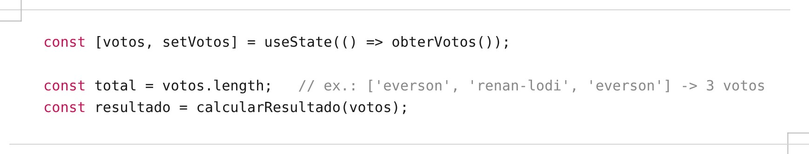

- `calcularResultado(votos)` devolve a lista ordenada do mais votado para o menos votado, com os campos `votos` e `percentual`. Nesta votação, o destaque vai para as duas primeiras posições:
    - o primeiro item (índice 0) é o Craque do Jogo: destaque-o com a classe `placar-craque` e o selo “Craque do jogo”;
    - o segundo item (índice 1) é o vice: destaque-o com a classe `placar-vice` e o selo “Vice”.
- Exiba a posição de cada jogador (1º, 2º, 3º, 4º) usando o índice recebido no `map()`.
- Acima do placar, mostre a situação da disputa pela liderança comparando o primeiro com o segundo colocado:

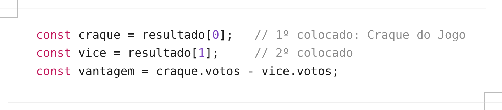

- Se a vantagem for 0: “Empate na liderança entre &lt;primeiro&gt; e &lt;segundo&gt;!”;
- Caso contrário: “&lt;primeiro&gt; lidera com N voto(s) de vantagem sobre &lt;segundo&gt;.” (cuidado com o singular e o plural: “1 voto”, “2 votos”).
- Monte a barra de progresso com style inline, usando o percentual como largura (``style={{ width: `${j.percentual}%` }}``), e formate o percentual no padrão brasileiro com `toLocaleString('pt-BR', { maximumFractionDigits: 1 })`.
- Quando o total for 0, use o operador ternário para exibir uma mensagem e um `Link` para `/votacao` no lugar do placar.
- Crie o botão **Desfazer último voto**. A função `desfazerUltimoVoto()` do service já devolve o array atualizado: aproveite esse retorno para atualizar o estado, sem precisar ler o localStorage de novo.
- Crie o botão **Zerar votação**, pedindo confirmação ao usuário. Lembre-se de que o estado vazio é um array:

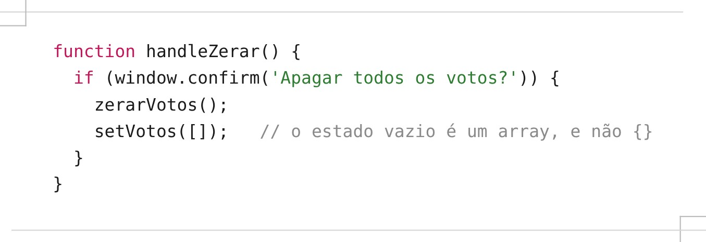

## [5,0 pts] Questão 3

Construa o arquivo `App.css`.

### Dicas

- Use as variáveis de cor já definidas no `index.css` fornecido (`--preto`, `--grafite`, `--grafite-claro`, `--branco`, `--cinza`, `--ouro`, `--prata`, `--gramado`, `--amarelo`) e as fontes `--fonte-titulo` e `--fonte-texto`.
- São 4 jogadores indicados. Use CSS Grid com 4 colunas fixas no desktop e media queries para passar para 2 colunas em telas de até 900px e para 1 coluna em telas de até 520px:

```css
.grade-indicados {
    display: grid;
    grid-template-columns: repeat(4, 1fr);
    gap: 1.2rem;
}
@media (max-width: 900px) {
    .grade-indicados {
        grid-template-columns: repeat(2, 1fr);
    }
}
```

- Para a grade do suspenso e dos demais jogadores do elenco, use `repeat(auto-fill, minmax(140px, 1fr))`.
- Padronize a proporção das fotos com `aspect-ratio: 3 / 4` e `object-fit: cover`. Atenção: as fotos fornecidas são verticais (retrato), então use `object-position: 50% 0` (ou `top`) para que o corte seja feito por baixo e o rosto do jogador nunca seja cortado.
- Crie uma classe para cada situação usada no `className` do card: `card-indicado` (borda `var(--ouro)`), `card-suspenso` (borda `var(--amarelo)`) e `card-elenco` (em preto e branco, por exemplo `filter: grayscale(1)`). Faça o mesmo para os selos: `selo-indicado` e `selo-suspenso`. Para posicionar o selo com `position: absolute`, o card precisa de `position: relative`.
- Destaque o card selecionado com `outline` (por exemplo, `outline: 5px solid var(--gramado)` e `outline-offset: 4px`) e faça o card “subir” com `transform: translateY(-8px)`. Coloque uma `transition` no `.card` para o movimento ficar suave.
- A barra de confirmação deve ficar grudada na parte de baixo da tela enquanto o usuário rola a página: use `position: sticky` com `bottom: 0` e um `z-index` para que ela fique acima dos cards.
- Estilize o botão desabilitado com a pseudo-classe `:disabled` (por exemplo, `opacity: 0.45` e `cursor: not-allowed`).
- No resultado, use cores diferentes na borda e na barra para `.placar-craque` (`var(--ouro)`) e `.placar-vice` (`var(--prata)`). Use `overflow: hidden` no contêiner (`.barra`) e uma `transition` na largura de `.barra-preenchida`, para a barra crescer suavemente.

## Observações

- Crie o projeto com o comando `npm create vite@latest VotacaoCraqueGalo -- --template react` e depois rode `npm install`.
- Copie a pasta `public` fornecida na prova (`jogadores`, `fonts` e `escudo-galo.svg`) para a raiz do projeto.
- Copie os arquivos `src/data/jogadores.js`, `src/services/votacaoService.js`, `src/components/Header.jsx`, `src/pages/Home.jsx` e `src/index.css` para as mesmas pastas do seu projeto. Atenção: os arquivos de dados e o service desta prova são diferentes dos das provas anteriores.
- Apague o `App.css` e a pasta `src/assets` gerados pelo template do Vite.
- Para conferir ou apagar os votos manualmente, use o DevTools do navegador em **Application > Local Storage** (chave `galo2026:craque-do-jogo`).
- Use a pasta `prints` como guia visual do projeto funcionando.
- Leia o arquivo `README.md` antes de começar a prova.
